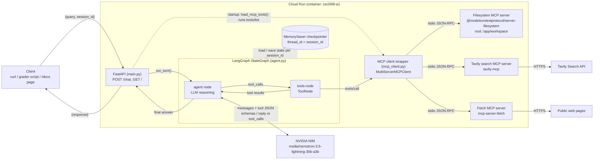
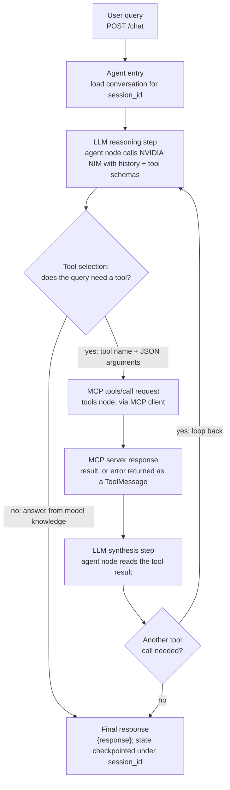
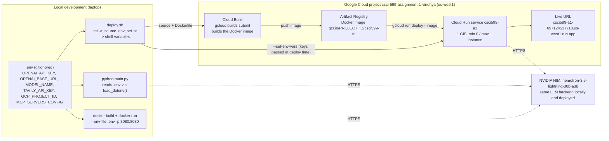

# Agentic MCP Assistant

A LangGraph agent that answers questions over HTTP, decides on its own whether a question needs a tool, calls tools on three MCP servers (filesystem, Tavily search, fetch), remembers the conversation per `session_id`, and runs on Google Cloud Run.

**Live URL:** https://csci599-a1-697124537718.us-west1.run.app
**Interactive API page:** https://csci599-a1-697124537718.us-west1.run.app/docs

| Component       | Choice                                                                                                   |
| --------------- | -------------------------------------------------------------------------------------------------------- |
| Agent framework | LangGraph (explicit `StateGraph`), `langchain-mcp-adapters`                                              |
| LLM backend     | NVIDIA NIM, Nemotron 3.5 Lightning (`nvidia/nemotron-3.5-lightning-30b-a3b`), OpenAI-compatible endpoint |
| MCP servers     | Filesystem, Tavily search, Fetch                                                                         |
| Memory          | LangGraph `MemorySaver` checkpointer, `thread_id = session_id`                                           |
| HTTP            | FastAPI + Uvicorn, `POST /chat`                                                                          |
| Hosting         | Google Cloud Run, `us-west1`, built with Cloud Build                                                     |

---

## Try it

```bash
URL=https://csci599-a1-697124537718.us-west1.run.app

# Filesystem tool
curl -s -X POST "$URL/chat" -H "Content-Type: application/json" \
  -d '{"query": "What does sample.txt say?", "session_id": "demo-1"}'

# Web search (Tavily)
curl -s -X POST "$URL/chat" -H "Content-Type: application/json" \
  -d '{"query": "What is the latest news about NVIDIA?", "session_id": "demo-2"}'

# No tool needed: answered from the model's own knowledge
curl -s -X POST "$URL/chat" -H "Content-Type: application/json" \
  -d '{"query": "What is 12 times 12?", "session_id": "demo-3"}'

# Memory across turns (same session_id)
curl -s -X POST "$URL/chat" -H "Content-Type: application/json" \
  -d '{"query": "My name is Vindhya.", "session_id": "demo-4"}'
curl -s -X POST "$URL/chat" -H "Content-Type: application/json" \
  -d '{"query": "What is my name?", "session_id": "demo-4"}'
curl -s -X POST "$URL/chat" -H "Content-Type: application/json" \
  -d '{"query": "What did I ask you last?", "session_id": "demo-4"}'

# Session isolation: a different session_id has no memory of demo-4
curl -s -X POST "$URL/chat" -H "Content-Type: application/json" \
  -d '{"query": "What is my name?", "session_id": "demo-6"}'

# Multi-step: search -> fetch -> write a file, then read it back
curl -s -X POST "$URL/chat" -H "Content-Type: application/json" \
  -d '{"query": "Search for a recent article about LangGraph, fetch it, and save a 2-line summary to langgraph.md", "session_id": "demo-5"}'
curl -s -X POST "$URL/chat" -H "Content-Type: application/json" \
  -d '{"query": "What does langgraph.md say?", "session_id": "demo-5"}'
```

You can also open the `/docs` page, choose `POST /chat`, click **Try it out**, edit the JSON body and click **Execute**.

**API contract**

```
POST /chat
  Request:  { "query": string, "session_id": string }   (both required, non-empty)
  Response: { "response": string }
GET /       -> { "status": "ok" }   (health check)
```

The first request after the service has been idle can take 10 to 20 seconds while Cloud Run starts an instance from zero.

---

## Architecture

### Diagram 1: System architecture



If the Mermaid diagram above does not render in your viewer, see the image: [docs/diagram-1-architecture.png](docs/diagram-1-architecture.png)

At startup, `mcp_client.py` reads `mcp_config.json`, runs `tools/list` against each server one at a time, and hands the discovered tools (name, description, JSON Schema) to the graph. The graph and its checkpointer are built once and shared by all requests, which is what lets memory persist between turns.

### Diagram 2: Tool invocation flow



If the Mermaid diagram above does not render in your viewer, see the image: [docs/diagram-2-tool-flow.png](docs/diagram-2-tool-flow.png)

The loop is the `tools -> agent` edge in `agent.py`. `tools_condition` routes to the tools node when the model returns tool calls and ends the turn when it returns plain text. A recursion limit of 20 graph steps stops a confused model from looping forever.

### Diagram 3: Deployment topology



If the Mermaid diagram above does not render in your viewer, see the image: [docs/diagram-3-deployment.png](docs/diagram-3-deployment.png)

Local development and the deployed service use the same cloud LLM backend (NVIDIA NIM); Ollama is not used. API keys never enter the image or the repository: locally they come from `.env`, and in the cloud they are passed to the service with `--set-env-vars`.

---

## MCP servers

| Server                           | Package                                                                                                                      | Transport | Tools                        | Used for                                                        |
| -------------------------------- | ---------------------------------------------------------------------------------------------------------------------------- | --------- | ---------------------------- | --------------------------------------------------------------- |
| Filesystem (recommended pair)    | [`@modelcontextprotocol/server-filesystem`](https://github.com/modelcontextprotocol/servers/tree/main/src/filesystem) (Node) | stdio     | 14                           | Read, write, list and edit files, sandboxed to `/app/workspace` |
| Tavily search (recommended pair) | [`tavily-mcp`](https://github.com/tavily-ai/tavily-mcp) (Node)                                                               | stdio     | 5, including `tavily_search` | Live web search for current information                         |
| Fetch (additional)               | [`mcp-server-fetch`](https://github.com/modelcontextprotocol/servers/tree/main/src/fetch) (Python)                           | stdio     | 1 (`fetch`)                  | Read the full content of a specific URL as markdown             |

All three are external open-source projects used as-is; none of them is reimplemented here. The server manifest is `mcp_config.json`. The Tavily key is not in that file; `mcp_client.py` injects `TAVILY_API_KEY` from the environment at startup and skips the Tavily server with a warning if the key is missing.

**Why fetch as the additional server.** Search and fetch do different jobs. Tavily finds pages and returns short snippets with URLs, while fetch returns the full text of one page. Together with the filesystem server they support a natural three-step chain: search for a source, read it in full, and save a summary. Fetch is also free, needs no API key, and works on any URL a user pastes directly, so it adds a capability without adding cost or another secret.

---

## How tool selection works

Tool choice is made by the LLM, not by keyword matching. On every reasoning step the model receives the system prompt (which describes when files, search, fetch, or no tool are appropriate), the conversation so far, and every discovered tool with its name, description and JSON Schema. It either returns tool calls with arguments that match those schemas, or answers directly. General-knowledge questions are answered from the model alone rather than forcing a tool call. Each turn logs the tools the model chose. Real lines from the deployed service:

```
session=log-file tools_used=['list_directory', 'read_text_file']
session=log-search tools_used=['tavily_search', 'fetch']
session=log-chain tools_used=['tavily_search', 'fetch', 'fetch', 'tavily_search', 'fetch', 'fetch', 'write_file']
session=grader-1 tools_used=none (answered directly)
```

---

## Error handling

The agent is built so that no MCP failure crashes the service or returns an unhandled 500.

| Failure mode                                             | Where it is handled                                                                                            | Behaviour                                                                                              |
| -------------------------------------------------------- | -------------------------------------------------------------------------------------------------------------- | ------------------------------------------------------------------------------------------------------ |
| Connection / transport failure at startup                | `mcp_client.load_mcp_tools`: each server discovered separately in its own `try/except`, with a 30 s timeout    | The failing server is logged as `unavailable` and skipped; the agent starts with the remaining servers |
| Connection / transport failure during a call             | Each `tools/call` is bounded by a 45 s timeout; any exception is caught by `ToolNode(handle_tool_errors=True)` | The error is returned to the LLM as a tool message and the agent explains what failed                  |
| Tool execution error (e.g. file not found)               | `handle_tool_error=True` on every MCP tool                                                                     | The server's error text goes back to the LLM, which reports it instead of guessing                     |
| Malformed or invalid response / arguments                | `ToolNode(handle_tool_errors=True)` catches parse and schema-validation errors                                 | Returned to the LLM as an error result; the turn continues                                             |
| Interrupted turn (e.g. client disconnects mid-tool-call) | `_close_dangling_tool_calls` in `agent.py`                                                                     | Unanswered tool calls in the saved history get an error result, so the session keeps working           |
| Anything else inside a turn                              | `try/except` in the `/chat` handler                                                                            | Logged with a traceback; the client gets a clean `{"response": "Sorry, something went wrong..."}`      |
| Slow LLM call                                            | `ChatOpenAI(timeout=60, max_retries=2)`                                                                        | A hung model call fails instead of blocking the request                                                |
| Bad request body                                         | Pydantic model on `/chat`                                                                                      | Empty or missing `query` / `session_id` returns HTTP 422                                               |

---

## Memory

Memory uses LangGraph's built-in `MemorySaver` checkpointer. Every request runs with `thread_id = session_id`, so each session has its own conversation history, and different sessions never see each other's messages. The system prompt is added on each model call rather than stored, so the checkpoint holds only the conversation.

Memory lives in the running instance's RAM. It lasts as long as the Cloud Run instance does and is lost when the instance scales to zero or is replaced, which the assignment explicitly allows (§4.4). For the same reason the service is deployed with `--max-instances 1`: with more than one instance, two turns of one session could reach different instances and the second would have no history. Files written to `/app/workspace` are also per-instance and temporary.

---

## Setup

### Prerequisites

- Python 3.14
- Node.js 22.22+, 24.15+ or 26 (the fetch server's `readabilipy` dependency needs a recent Node; the container uses Node 26)
- Docker Desktop
- Google Cloud CLI (`brew install --cask google-cloud-sdk`)
- Accounts and keys:
  - NVIDIA NIM API key from [build.nvidia.com](https://build.nvidia.com) (one key works for every model)
  - Tavily API key from [app.tavily.com](https://app.tavily.com) (free tier is enough)
  - A GCP project with billing linked to the education credit

### Install

Unzip the submission (or clone the repository) and move into the project folder:

```bash
cd Assignment-1

python3.14 -m venv env
source env/bin/activate
pip install -r requirements.txt          # includes the Python fetch server, mcp-server-fetch

npm install -g @modelcontextprotocol/server-filesystem tavily-mcp   # the two Node MCP servers

cp .env.example .env    # then fill in real values
```

### Environment variables

| Variable             | Purpose                                                                                              |
| -------------------- | ---------------------------------------------------------------------------------------------------- |
| `OPENAI_API_KEY`     | NVIDIA NIM key (`nvapi-...`); the OpenAI-compatible client reads it under this name                  |
| `OPENAI_BASE_URL`    | `https://integrate.api.nvidia.com/v1` (leave blank to use OpenAI directly)                           |
| `MODEL_NAME`         | Model ID exactly as shown on build.nvidia.com; deployed with `nvidia/nemotron-3.5-lightning-30b-a3b` |
| `TAVILY_API_KEY`     | Tavily key; if blank, the Tavily server is skipped                                                   |
| `GCP_PROJECT_ID`     | Project to build and deploy into (used by `deploy.sh`)                                               |
| `MCP_SERVERS_CONFIG` | Path to the server manifest (`./mcp_config.json` locally, `/app/mcp_config.json` in the container)   |

`.env` is gitignored and must never be committed. Only `.env.example`, with placeholders, is in the repository.

---

## Run locally

**Terminal 1: start the server**

```bash
source env/bin/activate
python main.py
```

The server reads `PORT` (default 8080) and binds to `0.0.0.0`. Wait until it logs the status of each MCP server and `Application startup complete.`:

```
MCP servers: {'filesystem': 'ok (14 tools)', 'tavily': 'ok (5 tools)', 'fetch': 'ok (1 tools)'}
INFO:     Application startup complete.
INFO:     Uvicorn running on http://0.0.0.0:8080 (Press CTRL+C to quit)
```

Leave this terminal running. The `tools_used` line for each request is printed here.

**Terminal 2: send requests**

```bash
URL=http://localhost:8080

curl -s -X POST "$URL/chat" -H "Content-Type: application/json" \
  -d '{"query": "What does sample.txt say?", "session_id": "local-1"}'

curl -s -X POST "$URL/chat" -H "Content-Type: application/json" \
  -d '{"query": "What is CAP theorem?", "session_id": "local-1"}'
```

With `URL` set to `http://localhost:8080`, every command in **Try it** also works locally. Alternatively, open `http://localhost:8080/docs` in a browser. Stop the server with `Ctrl+C` in Terminal 1.

### Run in Docker

```bash
docker build -t csci599-a1 .
docker run --rm --env-file .env -p 8080:8080 csci599-a1
```

Then send requests to `http://localhost:8080` from a second terminal exactly as above.

The image is a multi-stage build on `python:3.14-slim` that runs as a non-root user. Python dependencies live in a venv at `/opt/venv` so the non-root user can read them. Node comes from the official `node:26-slim` image, because Debian's packaged Node 20 is too old for the fetch server's `jsdom` dependency, and the Node MCP servers are pre-installed with `npm install -g` so cold starts don't download them.

### Tests

```bash
python -m pytest -v
```

- `tests/test_mcp_client.py`: tool discovery on the real filesystem and fetch servers, a real `tools/call`, a tool execution error that does not raise, and an unavailable server being skipped while the others still load.
- `tests/test_agent.py`: the agent uses the filesystem tool for a file question, answers a math question without calling any tool, keeps memory within a session and isolates it between sessions, and answers "What did I ask you last?".

The agent tests call the real NVIDIA endpoint, so they need a filled-in `.env`.

---

## Deploy

```bash
gcloud auth login
gcloud config set project <GCP_PROJECT_ID>
gcloud services enable run.googleapis.com cloudbuild.googleapis.com artifactregistry.googleapis.com

./deploy.sh
```

`deploy.sh` loads `.env` into the shell, builds the image with Cloud Build (`gcr.io/<project>/csci599-a1`, stored in Artifact Registry), and deploys it to Cloud Run in `us-west1` with `--allow-unauthenticated`, 1 GiB of memory, `--min-instances 0`, `--max-instances 1`, and the API keys passed through `--set-env-vars`. It prints the service URL at the end.

Memory is 1 GiB rather than the sample's 512 MiB because the container runs Python plus three MCP server processes, two of them on Node.

Read the service logs, including which tools each turn used:

```bash
gcloud run services logs read csci599-a1 --region us-west1 --limit 50
```

Note: the GCP project is billed to the education credit on my personal Google account, which is where the credit was applied, rather than my USC account.

---

## Cost disclosure

| Service                                            | Plan                                             | Cost                                                                |
| -------------------------------------------------- | ------------------------------------------------ | ------------------------------------------------------------------- |
| NVIDIA NIM                                         | Free developer key, about 40 requests per minute | $0                                                                  |
| Tavily                                             | Free tier                                        | $0                                                                  |
| Google Cloud Run + Cloud Build + Artifact Registry | $50 Google education credit                      | $0.00 for 1 to 13 October 2026 (Billing > Overview, before credits) |

Billing data can lag by up to a day, so the most recent deploys may not be reflected yet. Cloud Run scales to zero (`--min-instances 0`), so an idle service costs effectively nothing; charges come only from requests, image builds and image storage. One multi-step query makes several LLM calls, so very rapid bursts of requests can hit the NIM free-tier rate limit and respond more slowly.

---

## Project structure

```
.
├── main.py              # FastAPI app: POST /chat, GET /, reads PORT
├── agent.py             # LangGraph graph, system prompt, MemorySaver, run_turn()
├── mcp_client.py        # Loads mcp_config.json, tools/list per server, timeouts, failure isolation
├── mcp_config.json      # MCP server manifest (no secrets)
├── workspace/           # Filesystem server root (sample.txt is a test fixture)
├── tests/               # pytest suites for the MCP client and the agent
│   ├── test_mcp_client.py
│   └── test_agent.py
├── docs/                # PNG versions of the three architecture diagrams
│   ├── diagram-1-architecture.png
│   ├── diagram-2-tool-flow.png
│   └── diagram-3-deployment.png
├── requirements.txt
├── Dockerfile           # Multi-stage, non-root, Node 26 for the Node MCP servers
├── .dockerignore
├── .gitignore
├── deploy.sh            # Cloud Build + Cloud Run deploy
├── .env.example         # Placeholder environment variables
├── README.md
└── PROCESS_LOG.md
```

## Known limitations

- Memory and files in `/app/workspace` are lost when the Cloud Run instance recycles or scales to zero (allowed for this assignment).
- `--max-instances 1` keeps memory consistent but limits throughput to one instance.
- The NIM free tier is rate-limited (about 40 requests per minute).
- Some websites throttle or block automated requests from cloud IP ranges; the fetch tool then returns an error, which the agent reports.
